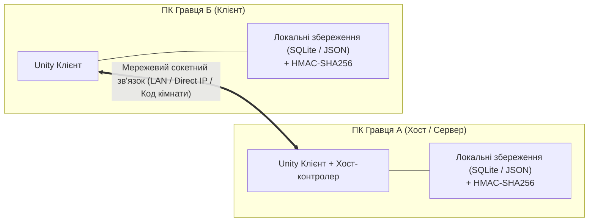
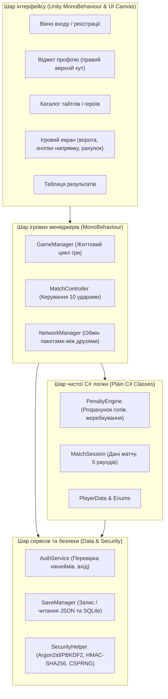
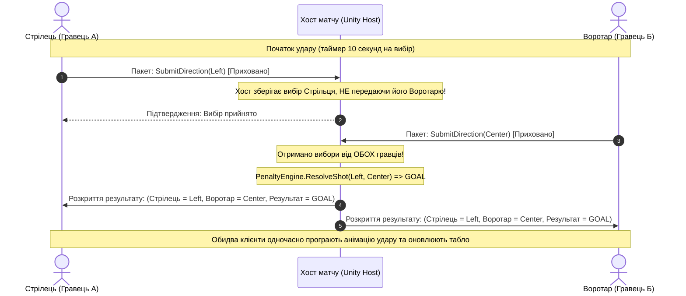
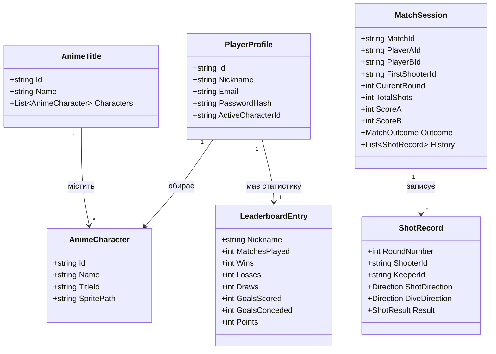

# Опис архітектури системи (Architecture Description) — Freekick

**Відповідно до положень міжнародного стандарту ISO/IEC/IEEE 42010:2022 (у спрощеному академічному форматі)**

| | |
| --- | --- |
| **Документ** | Architecture Description (AD) |
| **Система** | Freekick — Любительська онлайн-гра "Пенальті" для ПК (Unity C#) |
| **Версія** | 2.0.0 |
| **Дата оновлення** | 2026-10-12 |
| **Статус** | Approved / Baseline |
| **Автор** | Mykhailo Zaporozhchenko |

---

## 1. Ідентифікація архітектури та контекст

Система **«Freekick»** — це любительська комп'ютерна онлайн-гра (дуель 1v1 серії післяматчевих пенальті з аніме-персонажами) для платформи **PC (Windows)**, створена на ігровому рушії **Unity (C#)**.

Гра призначена для особистого користування та спільних матчів з друзями по мережі, а також виконується як практичне завдання до лабораторної роботи з дисципліни **«Безпека програм та даних» (Program Security Lab 2026)**.

Замість надмірно складних корпоративних підходів архітектура базується на **простій та прозорій модульній об'єктно-орієнтованій моделі (ООП на C#)** у середовищі Unity, що ідеально підходить для студентського проекту та навчальних завдань із захисту даних.

---

## 2. Зацікавлені сторони (Stakeholders & Concerns)

| Зацікавлена сторона | Роль | Ключові інтереси (Concerns) |
|---|---|---|
| **Гравці (Друзі / Користувачі)** | Кінцеві гравці | Зручність гри на ПК, простий запуск матчу з другом по мережі, вибір улюблених аніме-персонажів, чесний підрахунок очок. |
| **Викладач / Студент (Безпека ПЗ)** | Лабораторна робота | Дотримання вимог безпеки: надійне хешування паролів, захист від сніфінгу ходів (Anti-Sniffing), перевірка цілісності збережень (HMAC-SHA256), відсутність SQL-ін'єкцій. |
| **Розробник (Unity C#)** | Підтримка проекту | Простота коду, чиста ООП структура без громіздких патернів, розділення логіки та графіки (UI), легке тестування. |

---

## 3. Архітектурні представлення (Views)

### 3.1. Мережевий контекст (Network & System Topology)

Для гри з друзями використовується легка клієнт-серверна топологія з моделлю **Host-Authoritative** (один гравець запускає хост, інший підключається як клієнт через локальну мережу, прямий IP або код кімнати):

- **Хост-авторитет (Host-Authoritative):** гравець-хост або легкий локальний сокетний сервер тримає стан кімнати, синхронізує таймер та розраховує голи/сейви.
- **Збереження даних:** облікові записи та статистика зберігаються локально на кожному ПК у файлі `save.json` або базі `SQLite` з контрольною сумою HMAC-SHA256 для захисту від підробки значень.

---

### 3.2. Компонентна архітектура клієнта Unity (C#)

Архітектура коду організована за принципом простого поділу обов'язків:

---

### 3.3. Представлення безпеки: Захист від сніфінгу (Commit-Reveal)

Щоб суперник не міг перехопити напрямок удару через мережевий аналізатор трафіку (Wireshark), вибори напрямків надсилаються приховано і розкриваються одночасно:

---

### 3.4. Модель даних (Прості класи та зв'язки)

---

## 4. Журнал архітектурних рішень (ADR)

### ADR-001: Вибір Unity (C#) та легкого мережевого коду для ПК
- **Контекст:** Проект є любительською грою для особистого вжитку з друзями та завданням до лабораторної роботи з безпеки ПЗ. Розгортати важкі мікросервіси в хмарі є недоцільним та ресурсомістким.
- **Рішення:** Розробка на рушії Unity з мовою C# для платформи Windows. Мережева взаємодія реалізується через легкий C# код (Unity Netcode / Mirror / сокети) з підключенням за кодом кімнати або прямим IP.
- **Наслідки:** Швидка розробка, легкий запуск на ПК без необхідності орендувати сервери.

### ADR-002: Використання чистої та зрозумілої модульної ООП архітектури на C#
- **Контекст:** Проект створюється як любительська гра для гри з друзями та лабораторна робота. Надмірна кількість складних абстракцій і шаблонів корпоративного рівня ускладнювала розробку та розуміння простої гри в пенальті.
- **Рішення:** Використання класичного об'єктно-орієнтованого проектування (C# класи, моделі, менеджери `GameManager`, `MatchController`, `AuthService`, звичайні переліки).
- **Наслідки:** Код є лаконічним, легким для сприйняття, швидко модифікується та легко покривається юніт-тестами.

### ADR-003: Обов'язкове завершення всіх 5 раундів (10 ударів) та фіксація нічиєї
- **Контекст:** Для справедливого обліку статистики забитих та пропущених м'ячів між друзями необхідно зберігати повну історію серії.
- **Рішення:** Гра завжди триває рівно 5 раундів (по 5 ударів у кожного гравця, сумарно 10 ударів) незалежно від поточного відриву. При рівності голів після 10 ударів фіксується нічия (`Draw`), і обом гравцям нараховується по +1 очку в таблицю.
- **Наслідки:** Чесна та повна статистика матчів.

### ADR-004: Схема захисту від сніфінгу ходів та контроль цілісності сейвів
- **Контекст:** Лабораторна робота вимагає демонстрації практичних навичок захисту даних.
- **Рішення:**
  1. Приховане зведення ходів на хості (Commit-Reveal) для захисту від мережевого перехоплення пакетів у Wireshark.
  2. Додавання підпису HMAC-SHA256 до файлу збереження `save.json` для виявлення ручного редагування очок у блокноті.
  3. Хешування паролів із сіллю (Argon2id або PBKDF2).
- **Наслідки:** Повне виконання навчальних вимог дисципліни «Безпека програм та даних».
