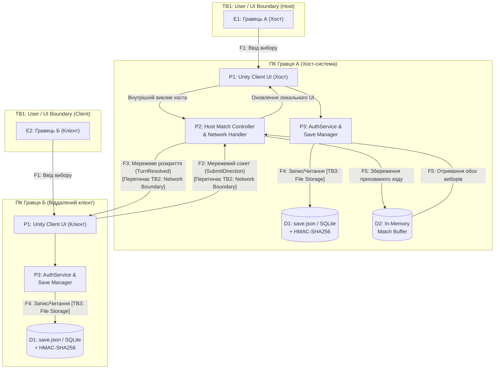

# Threat Model — Freekick (Anime Penalty Shootout Online PC)

| | |
| --- | --- |
| **Назва** | Модель загроз безпеки (STRIDE) — Freekick |
| **Версія** | 2.0.0 |
| **Статус** | Approved / Baseline |
| **Останнє оновлення** | 2026-10-25 |
| **Власник** | Mykhailo Zaporozhchenko (Розробник проекту) |
| **Пов'язані документи** | [`docs/architecture.md`](docs/architecture.md), [`docs/security_policy.md`](docs/security_policy.md), [`docs/srs.md`](docs/srs.md), [`docs/business_logic.md`](docs/business_logic.md), [`docs/project_policy.md`](docs/project_policy.md) |

---

## 1. Scope (Область аналізу та межі системи)

Ця модель загроз розроблена для комп'ютерної багатокористувацької онлайн-гри **«Freekick»** (післяматчеві пенальті 1 на 1 з аніме-персонажами під Windows) у рамках дисципліни **«Безпека програм та даних» (Program Security Lab 2026)**.

Аналіз охоплює специфіку любительського проекту для спільних матчів з друзями по мережі, побудованого за модульною об'єктно-орієнтованою архітектурою на **Unity (C#)** з моделлю **Host-Authoritative**.

### 1.1. Об'єкти, що входять до меж аналізу (In Scope):
- **Клієнтський застосунок Unity (PC / Windows):** інтерфейс користувача (вхід/реєстрація, віджет профілю у правому верхньому куті, каталог персонажів, ігровий екран воріт та табло рахунку).
- **Мережева взаємодія для гри з друзями:** передача пакетів через сокети (LAN, Direct IP, код кімнати) між Хостом (Host) та Клієнтом (Client).
- **Ігровий двигун та стан матчу:** розрахунок взяття воріт (`PenaltyEngine`), правило 5 обов'язкових раундів (10 ударів), жеребкування черги ударів, сценарій нічиєї (`Draw`).
- **Схема прихованого вводу ходів (Anti-Sniffing Commit-Reveal):** протокол обробки вибору напрямків на хості без розкриття інформації супернику до фіксації обох рішень.
- **Модуль автентифікації та профілів (`AuthService`):** перевірка унікальності нікнеймів, хешування паролів із сіллю (Argon2id / PBKDF2).
- **Локальні сховища даних (`SaveManager`):** файли збережень `save.json` та/або SQLite з контрольною сумою **HMAC-SHA256**.

### 1.2. Об'єкти поза межами аналізу (Out of Scope):
- Захист ядра операційної системи Windows та фізична безпека апаратного забезпечення комп'ютерів гравців.
- Захист від модифікації оперативної пам'яті через Ring-0 драйвери чи інструменти типу Cheat Engine (не є актуальним для навчального проекту без грошових ставок та комерційного призового фонду).
- Внутрішня інфраструктура сторонніх віртуальних мереж (Radmin VPN, Hamachi).
- Корпоративні загрози для великих публічних серверів (DDoS-атаки на сотні гігабіт, компрометація хмарних дата-центрів).

---

## 2. System Overview & DFD (Опис системи та діаграма потоків даних)

Для структурованого аналізу загроз за методологією **STRIDE** побудовано модель потоків даних (Data Flow Diagram, DFD).

### 2.1. Елементи моделі DFD

| ID | Тип DFD (DFD Type) | Назва елемента | Опис та роль у системі |
|---|---|---|---|
| **E1** | External Interactor | Player A (Host) | Гравець-хост: взаємодіє з локальним клієнтом, запускає лобі, обирає напрямок удару/сейву. |
| **E2** | External Interactor | Player B (Client) | Гравець-клієнт: друг, який підключається по мережі, обирає напрямок удару/сейву. |
| **P1** | Process | Unity Client Process | Клієнтський процес Unity: відображає UI, зчитує ввід гравця, валідує поля форми, оновлює графіку. |
| **P2** | Process | Host Match Controller & Network Handler | Хост-контролер: координує сесію, таймер ходу (10 с), буфер Commit-Reveal, розраховує голи через `PenaltyEngine`. |
| **P3** | Process | AuthService & Save Manager | Модуль безпеки даних: хешує паролі, підписує та верифікує збереження за допомогою HMAC-SHA256. |
| **D1** | Data Store | Local Save File / SQLite (`save.json`) | Локальне сховище на диску: облікові записи, статистика перемог/поразок/нічиїх, HMAC-підпис. |
| **D2** | Data Store | In-Memory Match Buffer | Тимчасовий буфер пам'яті хоста: приховані вибори ходів до моменту їх одночасного розкриття. |
| **F1** | Data Flow | Player Input $\rightarrow$ Unity Client | Ввід гравця (миша / клавіатура `A-W-D`) у клієнтський додаток. |
| **F2** | Data Flow | Client $\rightarrow$ Host Network Packets | Мережевий потік пакетів від віддаленого гравця до хоста (`JoinRoom`, `SubmitDirection`). |
| **F3** | Data Flow | Host $\rightarrow$ Client State Broadcast | Мережевий потік сповіщень від хоста до клієнта (`TurnResolved`, `MatchFinished`). |
| **F4** | Data Flow | Auth/Save Data $\rightarrow$ Local Storage | Запис та читання даних збереження з контрольною сумою HMAC-SHA256 на локальний диск. |
| **F5** | Data Flow | Match State Updates $\rightarrow$ In-Memory Buffer | Збереження та вилучення прихованих ходів у оперативному буфері хоста. |
| **TB1** | Trust Boundary | User / Client UI Boundary | Межа довіри між користувачем (зовнішній суб'єкт) та клієнтським додатком Unity. |
| **TB2** | Trust Boundary | Network Boundary (Client / Host) | Межа довіри через мережу передачі даних (недовірений канал, потенційний сніфінг трафіку). |
| **TB3** | Trust Boundary | Application / Persistent Storage Boundary | Межа довіри між запущеним процесом гри та файловою системою Windows (захист від редагування блокнотом). |

---

### 2.2. Діаграма потоків даних (DFD Level 1)

---

## 3. Canonical STRIDE Matrix (Канонічна відповідність елементів типам загроз)

Відповідно до стандарту STRIDE, різні типи елементів DFD піддаються різним категоріям загроз:

| Тип елемента DFD | Spoofing (S) | Tampering (T) | Repudiation (R) | Information Disclosure (I) | Denial of Service (D) | Elevation of Privilege (E) |
|---|:---:|:---:|:---:|:---:|:---:|:---:|
| **External Interactor (E)** | ✓ | — | ✓ | — | — | — |
| **Data Flow (F)** | — | ✓ | — | ✓ | ✓ | — |
| **Data Store (D)** | — | ✓ | — | ✓ | ✓ | — |
| **Process (P)** | ✓ | ✓ | ✓ | ✓ | ✓ | ✓ |

*Позначення категорій STRIDE:*
- **S** — Підміна особи (Spoofing)
- **T** — Фальсифікація / спотворення даних (Tampering)
- **R** — Відмова від авторства дій (Repudiation)
- **I** — Розкриття конфіденційної інформації (Information Disclosure)
- **D** — Відмова в обслуговуванні (Denial of Service)
- **E** — Несанкціоноване підвищення привілеїв (Elevation of Privilege)

---

## 4. Comprehensive STRIDE Threat Analysis Table (Детальний аналіз загроз Freekick)

Нижче наведено повний перелік специфічних загроз для проекту Freekick, заповнений для кожного релевантного елемента системи з описом можливих наслідків та технічних контрзаходів.

| ID Елемента | Назва елемента | Категорія STRIDE | Опис конкретної загрози для Freekick | Технічний контрзахід у проекті (Mitigation) |
|---|---|:---:|---|---|
| **E1 / E2** | Гравці (External Interactors) | **S** | Гравець намагається увійти під чужим обліковим записом або скопіювати чужий файл збереження `save.json`. | Перевірка пароля через стійкий криптографічний хеш із сіллю (Argon2id/PBKDF2). |
| **E1 / E2** | Гравці (External Interactors) | **R** | Гравець після поразки заперечує свій вибір або заявляє, що гра не зарахувала гол / зарахувала помилковий результат. | Ведення структурованої локальної історії всіх 10 ударів (`List<ShotRecord>`) у `MatchSession` із фіксацією виборів обох сторін. |
| **F1** | Player Input $\rightarrow$ Unity Client | **T** | Спроба передати з інтерфейсу некоректне значення напрямку удару (наприклад, від'ємне число або число більше 2). | Жорстка типізація через C# `enum Direction { Left=0, Center=1, Right=2 }` та валідація на рівні контролера форми. |
| **F1** | Player Input $\rightarrow$ Unity Client | **I** | Перехоплення вводу пароля з клавіатури сторонніми шкідливими програмами (Keylogger). | Поле вводу пароля в Unity має прапорець `ContentType = Password` (маскування символів зірочками). |
| **F1** | Player Input $\rightarrow$ Unity Client | **D** | Швидкий спам кліками по кнопках вибору напрямку для виклику переповнення черги обробки подій Unity UI. | Блокування повторних натискань кнопок вибору (`Interactable = false`) одразу після першого кліку до початку наступного раунду. |
| **F2** | Client $\rightarrow$ Host Network Packets | **T** | Перехоплення та модифікація мережевого пакету `SubmitDirection` у транзиті (підміна напрямку суперника або ID гравця). | Валідація ідентифікатора відправника на хості; перевірка, чи належить цей хід саме поточному стрільцю/воротарю. |
| **F2** | Client $\rightarrow$ Host Network Packets | **I** | **Мережевий сніфінг (Sniffing через Wireshark):** недобросовісний гравець перехоплює трафік, щоб підглянути вибір напрямку удару суперника до свого стрибка. | **Механізм Anti-Sniffing (Commit-Reveal):** хост зберігає отриманий вибір приховано і не відправляє його супернику до моменту отримання обох виборів. |
| **F2** | Client $\rightarrow$ Host Network Packets | **D** | Гравець навмисно затримує або не надсилає свій вибір, блокуючи перебіг гри для іншого учасника. | Впровадження обов'язкового тайм-ауту ходу (10 секунд); після завершення часу хост автоматично обирає випадковий або дефолтний напрямок. |
| **F3** | Host $\rightarrow$ Client State Broadcast | **T** | Спотворення результату раунду або фінального табло рахунку під час широкомовного повідомлення клієнту. | Клієнт звіряє отриманий результат зі своїми локальними даними раунду та відображає підтверджений стан. |
| **F3** | Host $\rightarrow$ Client State Broadcast | **I** | Передчасний витік прихованого ходу одного гравця у широкомовний пакет до отримання ходу другого гравця. | Хост формує пакет `TurnResolved` виключно після того, як у буфері зафіксовано вибори обох учасників. |
| **F3** | Host $\rightarrow$ Client State Broadcast | **D** | Розрив мережевого з'єднання гравцем, який програє матч («Rage Quit»), з метою зірвати запис перемоги переможцю. | Хост детектує обрив зв'язку, зараховує гравцю, що відключився, технічну поразку та коректно оновлює статистику переможця. |
| **F4** | Auth/Save $\rightarrow$ Local Storage | **T** | Спотворення або підміна файлу збереження `save.json` під час запису на диск (збій живлення або зовнішнє втручання). | Атомарний запис через тимчасовий файл (`save.json.tmp` $\rightarrow$ перейменування) із генерацією підпису HMAC-SHA256. |
| **F4** | Auth/Save $\rightarrow$ Local Storage | **I** | Читання конфіденційних даних інших облікових записів або паролів із файлу збереження. | Паролі зберігаються виключно у вигляді незворотних криптографічних хешів із сіллю; конфіденційні платіжні дані відсутні. |
| **F4** | Auth/Save $\rightarrow$ Local Storage | **D** | Блокування файлу збереження іншим додатком або антивірусом, що спричиняє падіння через `IOException`. | Безпечна обробка винятків введення-виведення через блоки `try-catch` із повторною спробою запису. |
| **D1** | Local Save File / SQLite (`save.json`) | **T** | **Ручне редагування збереження в `Notepad.exe`:** гравець вручну змінює у JSON кількість перемог, голів чи очок лідерборду. | **Захист HMAC-SHA256:** файл містить перевірочний геш-підпис вмісту. При зміні хоча б одного символу підпис стає недійсним і гра відхиляє сейв. |
| **D1** | Local Save File / SQLite (`save.json`) | **I** | Розкриття збережених облікових записів при передачі файлу `save.json` стороннім особам. | Відсутність паролів у відкритому вигляді; солі паролів зберігаються разом із хешами, що робить райдужні таблиці неефективними. |
| **D1** | Local Save File / SQLite (`save.json`) | **D** | Навмисне видалення або синтаксичне пошкодження файлу `save.json`, що унеможливлює запуск гри. | Перевірка цілісності при старті: у разі критичного пошкодження гра створює новий чистий файл збереження за замовчуванням. |
| **D2** | In-Memory Match Buffer | **T** | Модифікація значень буфера ходів у пам'яті хоста перед обчисленням гола. | Інкапсуляція буфера у приватні поля `private readonly` класу `MatchController` без публічних сеттерів. |
| **D2** | In-Memory Match Buffer | **I** | Читання незавершених ходів із буфера пам'яті. | Очищення тимчасового буфера виборів одразу після розрахунку удару через `PenaltyEngine.ResolveShot()`. |
| **D2** | In-Memory Match Buffer | **D** | Переповнення пам'яті завислими сесіями матчів. | Одночасна підтримка лише однієї активної сесії матчу в любительському клієнті 1v1. |
| **P1** | Unity Client Process | **S** | Клієнт намагається видати себе за хоста матчу у сесії. | Чітке розділення ролей при старті: хост створює сокет-сервер (`StartHost()`), клієнт лише підключається (`StartClient()`). |
| **P1** | Unity Client Process | **T** | Введення спецсимволів або SQL-конструкцій у поля форми реєстрації (нікнейм, email). | Валідація нікнейму за регулярним виразом `^[a-zA-Z0-9_-]{3,20}$`; екранування / параметризація запитів. |
| **P1** | Unity Client Process | **R** | Клієнт стверджує, що не натискав кнопку вибору удару. | Локальне журналювання стану раунду та підтвердження отримання кліку перед відправкою. |
| **P1** | Unity Client Process | **I** | Випадкове логування паролів, секретних ключів або персональних даних у системний консольний лог `Player.log`. | Повна заборона викликів `Debug.Log()` із чутливими аргументами у релізному коді. |
| **P1** | Unity Client Process | **D** | Зависання графічного інтерфейсу Unity через очікування відповіді від мережевого сокета. | Асинхронна робота з мережею (`async/await`, `UniTask` або неблокуючі сокети Unity Netcode). |
| **P1** | Unity Client Process | **E** | Клієнт намагається викликати методи дострокового завершення матчу або зміни рахунку. | Клієнт має доступ лише до відправки власного вибору; обробка логіки результату дозволена виключно на хості. |
| **P2** | Host Match Controller & Network Handler | **S** | Підключення несанкціонованого стороннього гравця до приватної кімнати друзів. | Використання унікального коду кімнати (Room Code) або авторизаційного токена підключення. |
| **P2** | Host Match Controller & Network Handler | **T** | Надсилання клієнтом вибору напрямку удару поза межами 5 обов'язкових раундів (після 10-го удару). | Хост суворо перевіряє лічильник ударів `TotalShotsTaken < 10`; після 10-го удару стан перемикається у `MatchFinished`. |
| **P2** | Host Match Controller & Network Handler | **R** | Гравець-хост маніпулює жеребкуванням черги першого удару на власну користь. | Використання криптографічно стійкого генератора випадкових чисел `RandomNumberGenerator` (`CSPRNG`) для 50/50 жеребкування. |
| **P2** | Host Match Controller & Network Handler | **I** | Передача хостом інформації про напрямок удару стрільця у сокет воротаря до моменту вибору воротаря. | Сувора логічна ізоляція в коді `MatchController.cs`: пакет `TurnResolved` відправляється клієнту тільки після виклику `ResolveCurrentTurn()`. |
| **P2** | Host Match Controller & Network Handler | **D** | Зависання циклу матчу через ненадходження вибору від клієнта. | Запуск 10-секундного таймера на кожен хід; при вичерпанні таймера хід вважається пропущеним або обирається за дефолтом. |
| **P2** | Host Match Controller & Network Handler | **E** | Клієнт надсилає повідомлення про зміну рахунку або фальсифікований стан матчу. | Модель **Host-Authoritative**: хост повністю ігнорує будь-які пакети клієнта, окрім власного вибору напрямку `SubmitDirection`. |
| **P3** | AuthService & Save Manager | **S** | Реєстрація користувача-клона зі зміненим регістром символів (наприклад, `Admin` при наявності `admin`). | Перевірка унікальності нікнейму проводиться без урахування регістру: `nickname.ToLowerInvariant()`. |
| **P3** | AuthService & Save Manager | **T** | Спроба SQL-ін'єкції у локальну базу даних SQLite для модифікації статистики чи таблиці паролів. | Використання виключно параметризованих запитів `SqliteCommand.Parameters.AddWithValue()`. |
| **P3** | AuthService & Save Manager | **R** | Користувач стверджує, що не змінював пароль або не реєстрував обліковий запис. | Фіксація часу реєстрації та оновлення облікового запису в локальному профілі. |
| **P3** | AuthService & Save Manager | **I** | Збереження паролів у відкритому вигляді (Plaintext) або використання застарілих алгоритмів хешування (MD5, SHA-1). | Використання Argon2id або PBKDF2 (HMAC-SHA256, $\ge 100\,000$ ітерацій) з унікальною 16-байтною сіллю на кожного користувача. |
| **P3** | AuthService & Save Manager | **D** | Виснаження ресурсів комп'ютера надмірною кількістю спроб входу з ресурсоємним хешуванням (CPU exhaustion). | Додавання штучної затримки при невдалих спробах автентифікації та ліміт на кількість невдалих спроб входу. |
| **P3** | AuthService & Save Manager | **E** | Отримання несанкціонованого доступу до чужого локального профілю без валідації пароля. | Суворе порівняння криптографічного хешу введеного пароля з збереженим хешем у безпечному режимі без витоку за часом (constant-time comparison). |

---

## 5. Security Controls & Mitigations Summary (Зведена таблиця заходів захисту)

| Захисний механізм | Реалізація в C# / Unity | Загрози STRIDE, що нівелюються | Спосіб перевірки |
|---|---|---|---|
| **Argon2id / PBKDF2 з сіллю** | `Security/PasswordHasher.cs` (`Rfc2898DeriveBytes` / Konscious Argon2id, 16-байтна CSPRNG сіль) | **S, I** (підміна акаунта, витік відкритих паролів) | Автотест `PasswordHashingTests` у `Tests/Editor/` |
| **HMAC-SHA256 контрольний підпис** | `Security/SaveIntegrity.cs` (`HMACSHA256.ComputeHash`) | **T** (модифікація збережень і статистики в `Notepad.exe`) | Автотест `SaveIntegrityTests` (детекція підробки 1 байта) |
| **Commit-Reveal схема ходів** | `Network/CommitRevealHandler.cs` (буферизація виборів на хості до розкриття) | **I, T** (сніфінг ходів у Wireshark, підміна вибору) | Мережевий інтеграційний тест `CommitRevealTests` |
| **Host-Authoritative модель** | `Managers/MatchController.cs` (хост розраховує голи, клієнт лише надсилає свій вибір) | **T, E** (фальсифікація рахунку, підвищення привілеїв) | Юніт-тест `MatchAuthorityTests` |
| **CSPRNG жеребкування** | `Security/CryptoRandom.cs` (`RandomNumberGenerator.Create()`) | **R, T** (маніпуляція чергою удару, упередженість) | Статистичний автотест `CsprngFairnessTests` |
| **Таймер ходу (10 секунд)** | `MatchController.cs` (`IEnumerator` / `UniTask` тайм-аут на хід) | **D** (зависання гри через бездіяльність клієнта) | Тест тайм-ауту ходу в `Tests/Runtime/` |
| **Валідація Regex & Lowercase** | `Identity/AuthService.cs` (`^[a-zA-Z0-9_-]{3,20}$`, `ToLowerInvariant()`) | **T, S** (ін'єкції спецсимволів, клонування ніків) | Автотест `NicknameValidationTests` |
| **Правило 5 обов'язкових раундів** | `Core/PenaltyEngine.cs` (контроль 10 ударів сумарно, сценарій `Draw`) | **T, R** (достроковий вихід, нечесна статистика) | Автотест `MandatoryTenShotsTests` |

---

## 6. Висновки

Розроблена модель загроз за методологією **STRIDE** охоплює всі критичні точки взаємодії десктопної гри **Freekick**: інтерфейс користувача, мережевий сокетний обмін 1v1 між друзями, логіку обчислення результату дуелі та збереження локальних профілів і статистики.

Запропоновані контрзаходи повністю відповідають масштабу любительського проекту під ПК та гарантують виконання ключових академічних вимог дисципліни **«Безпека програм та даних»**: криптографічний захист паролів, захист від мережевого сніфінгу ходів через Wireshark, перевірку цілісності збережень через HMAC-SHA256 та чесне жеребкування через CSPRNG.
